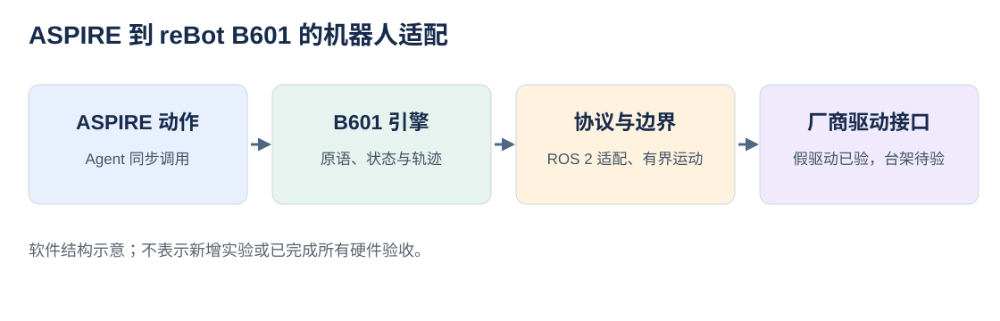

# ASPIRE Adapter for reBot B601

**Software adaptation and fake-driver verification**

This project connects ASPIRE robot primitives, the ROS 2 vendor protocol, motion states and TraceRecord to a B601 adapter. Software behavior is checked with a fake driver before physical bench integration. AgiBot A2 belongs to an earlier simulation execution-layer trial; B601 is the current adaptation target, and the old A2 run guide is retained as historical documentation.

**Research question:** How can synchronous ASPIRE action calls connect to asynchronous B601 motion, state feedback and bounded execution?

**Current results:** The B601 engine, motion states, ROS 2 protocol and execution entry points are implemented. Archived software checks report 27 passing tests. These tests did not move a physical robot and do not establish real calibration, grasping or a complete inspection task. [Analysis and limitations](docs/evidence/oct-m3/README.md).

## Demos and Images



Architecture illustration, not a runtime screenshot or hardware demonstration. The fake vendor driver checks software boundaries; physical bench validation remains outstanding. [Software checks and evidence](docs/evidence/oct-m3/README.md).

## Work

The work covers reproduction, implementation, integration and analysis. Methods introduced in upstream ASPIRE / HarnessVLA papers remain credited to their authors. Shared code history and documentation updates are not counted as new implementation.

| Work | Details | Inspect |
|---|---|---|
| Robot primitives and traces | Translate ASPIRE actions into B601 engine calls and retain traceable execution results. | [Code / evidence](robot_b601/engine.py) |
| ROS 2 vendor protocol adaptation | Separate protocol, transport and execution states so fake and physical drivers can be integrated. | [Code / evidence](robot_b601/ros_transport.py) |
| Motion states and execution limits | Implement bounded execution, state feedback and exception handling. Physical safety still requires bench validation. | [Code / evidence](robot_b601/motion.py) |
| Hardware entry points and fake-driver checks | The name real identifies the intended implementation path; the archived tests use a fake driver. | [Code / evidence](scripts/b601_real_first_light.py) |

Follow the [implementation-to-evidence mapping](docs/evidence/oct-m3/implementation-commits.csv) to inspect actual implementation commits separately from documentation and evidence-packaging commits.

## Milestones and Status

| Stage | Technical evidence | Scope |
|---|---|---|
| Foundation and interface preparation | Code navigation below; [historical technical guide](docs/history/agibot-a2-run-guide.md) | Simulation, software checks and physical trials are identified separately |
| October / M3 integration | [Implementation and verification index](docs/evidence/oct-m3/README.md) | Inspectable implementation and listed tests; not a claim that all contractual items have been accepted |
| November / M4 comparison | [Comparison and demonstration index](docs/evidence/nov-m4/README.md) | Existing results and failure analysis; wireless comparisons and two industrial demonstrations remain incomplete |
| December / M5 preparation | [Reproduction, archive and follow-up work](docs/evidence/dec-m5/README.md) | Preparation / partial evidence; full clean-machine reconstruction, final demonstration and large-file retrieval remain outstanding |

Months label delivery stages; original records give experiment dates. Evidence packaging and no-hardware checks on 2026-11-14 do not imply new physical or simulated experiments on that date. See the [reading guide](docs/portfolio/README.md) for details.

## Limitations and Next Steps

Physical first motion, real calibration, grasping and the capstone still require bench validation. The presence of hand_eye or other configuration files is not proof of real calibration. HarnessVLA B601 videos belong to a separate pipeline and cannot establish hardware execution for this repository.

## Code Navigation and Verification

| Path | Contents |
|---|---|
| `robot_b601/` | B601 engine, protocol, motion states and execution limits |
| `scripts/b601_*` | Bench entry points and fake vendor driver |
| `tests/b601/` | Tests that require no robot hardware |
| `docs/evidence/` | Verification records and outstanding work |

The following is a software-check entry point for an existing configured environment. Follow the [reproduction notes](docs/evidence/dec-m5/reproduce.md) for exact dependencies and platform requirements. This documentation update did not rerun the full experiments and does not require reviewers to move a physical arm.

```sh
python3 -m pytest tests/b601/ -q -p no:anyio
```

## Related Projects

| Project | Research / verification environment |
|---|---|
| [ASPIRE Skill Accumulation Reproduction](https://github.com/23garyd/aspire-sim-reproduction) | Simulation research |
| [ASPIRE Adapter for reBot B601](https://github.com/23garyd/aspire-robot-B601) | Software adaptation and fake-driver verification |
| [HarnessVLA Frozen-Policy and Harness Reproduction](https://github.com/23garyd/harnessvla-sim-reproduction) | LIBERO-Pro simulation research |
| [HarnessVLA Experiments on reBot B601](https://github.com/23garyd/harnessvla-rebot-b601) | Physical B601 research and engineering validation |

These are related but distinct reproduction and engineering projects. Results are reported separately. See the repository citations and license notices for upstream attribution.
