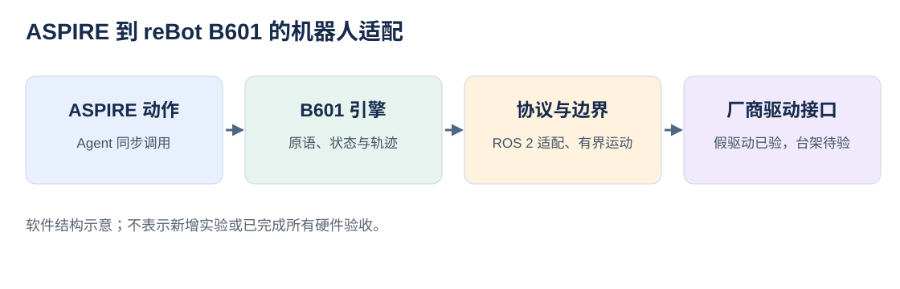

# ASPIRE 到 reBot B601 的机器人适配 评审阅读指南

本页帮助评审者从问题、实现、证据和局限理解 Gary 的实习工作。概览与演示见[首页](../../README.md)。

## 当前交付定位

这是 Gary 实习中的 B601 适配层项目。它将机器人原语、ROS 2 厂商协议、动作状态和 TraceRecord 连接起来，先用假驱动验证软件行为，为实体台架联调准备执行入口。

已提供 B601 引擎、运动状态、ROS 2 协议和执行入口；归档软件检查为27项通过。这些测试没有驱动物理机器人，不能当作实机标定、抓取或完整巡检成功。

首次实体动作、真实标定、抓取和 capstone 仍需台架验证。hand_eye 等配置不能因文件存在就认定为真实标定。HarnessVLA 的 B601 视频属于另一条 pipeline，不能作为本仓库的实机证明。

## 软件结构

图为代码结构说明，执行与实测范围仍按正文证据解释。

## 贡献与来源

本项目复现已有研究并完成工程实现、实验和分析，不声称发明上游论文方法。[实现提交映射](../evidence/oct-m3/implementation-commits.csv)区分源代码贡献与证据整理。两个ASPIRE仓库有共享历史，不能把相同文件或仿真片段重复计作两次成果。本次增加阅读说明和素材入口，未新增训练、rollout或机器人动作。

## 证据等级

| 等级 | 可以支持的判断 | 不能替代的证明 |
|---|---|---|
| 源代码与无硬件测试 | 接口、控制逻辑、错误处理及部分边界 | 真实机械臂动作、标定与物理安全 |
| 仿真结果和视频 | 指定仿真环境、条件和个案行为 | B601实机或工业部署 |
| 实机结果、视频与遥测 | 所示实体试验的过程和原始结局 | 其他pipeline、其他任务或未测的无线性能 |
| 固定提交与哈希 | 来源文件可追踪，整理版本可复核 | 实验发生时间、结果成功或合同最终验收 |

媒体来源见[media-provenance.json](media-provenance.json)。如有海报，均为现有视频1秒处直接抽帧，未用生成图像替代实验画面。软件结构图是解释性示意，不是运行证据。

## 阶段与证据入口

[October／M3](../evidence/oct-m3/README.md)、[November／M4](../evidence/nov-m4/README.md)、[December／M5](../evidence/dec-m5/README.md)分别保留技术范围与缺口。原始实验发生在其记录日期，不能按交付月份改写时间线。

本仓库保持原访问权限。技术页面不包含发票、商业合同或付款信息。

## 历史仿真平台

AgiBot A2用于早期仿真执行层验证，旧操作说明已移至[历史指南](../history/agibot-a2-run-guide.md)。它不是B601目标硬件，也不作为当前B601实机完成的证据。
